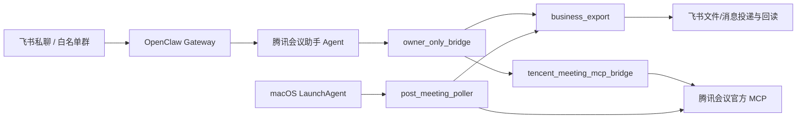

# 腾讯会议助手

这是一个运行在本机 OpenClaw Gateway 上的飞书腾讯会议助手项目。OpenClaw 负责飞书 WebSocket 通道、Agent 和 MCP 宿主；本仓库负责腾讯会议桥接、隐私与来源登记、资料导出、消息投递及会后自动化。

## 架构

## 功能

- 预约、改期、查询和取消腾讯会议。
- 查询会议纪要、逐字稿和录播信息。
- 按当前飞书会话交付 Markdown 纪要/逐字稿或录播链接卡片，并验证投递结果。
- 为助手创建的公司会议保存来源记录；手动和自动导出使用登记和发送账本。
- 会后轮询器等待明确的会议结束状态及逐字稿、录播链接就绪，再按配置投递。

## 目录

- `src/`：生产代码。
- `tests/`：离线测试，必须使用合成数据。
- `prompts/assistant-rules.md`：OpenClaw 工作区行为规则的源文件，部署时与运行工作区保持同一份。
- `config/runtime.example.json`：路径配置示例。
- `config/runtime.local.json`：本机路径、内部 ID 等设置；不纳入 Git。
- `scripts/deploy.sh`：生成轮询器 LaunchAgent 配置并部署。
- `scripts/`：状态检查、部署、暂停/恢复入口。

会议数据、密钥、OpenClaw 配置、投递账本和日志不属于仓库，路径由本机 `config/runtime.local.json` 管理。首次在新机器部署前，先按示例建立本机配置并确认数据目录和服务身份。

## 当前本机部署

本机部署由 `scripts/deploy.sh` 管理：OpenClaw MCP 指向 `src/owner_only_bridge.py`，会后轮询器由 `ai.openclaw.post-meeting-poller` 每分钟唤醒。当前飞书通道使用一个私聊白名单和两个群白名单，群聊需 @ 助手。会后自动发送开关由 `~/.openclaw/automations/post-meeting-export.json` 控制。

旧的验收记录保存在原数据目录，部分记录描述的是早期关闭状态；实时行为以本机 OpenClaw 配置和自动化配置为准。查看 [架构与运行说明](docs/architecture-and-operations.md)。
